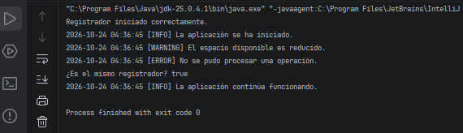

# Ejercicio 3: Registro de Eventos (Logger) Básico

## Descripción

Este ejercicio implementa el patrón de diseño **Singleton** en Java para centralizar el registro de eventos de una aplicación.

La clase `AppLogger` permite registrar mensajes con distintos niveles de severidad, añadiendo automáticamente una marca de tiempo y almacenando los registros en un archivo de texto.

## Objetivos

- Aplicar Singleton para centralizar el registro de eventos.
- Impedir la creación de instancias adicionales mediante un constructor privado.
- Registrar mensajes de tipo `INFO`, `WARNING` y `ERROR`.
- Añadir automáticamente la fecha y hora a cada mensaje.
- Guardar los registros en un archivo de texto.
- Sincronizar las operaciones de escritura para evitar conflictos entre hilos.

## Implementación del patrón Singleton

La clase `AppLogger` utiliza los siguientes elementos:

- **Instancia estática:** mantiene la referencia al único registrador.
- **Constructor privado:** impide crear instancias directamente desde otras clases.
- **Método `getInstance()`:** proporciona acceso a la instancia única.
- **Métodos `logInfo()`, `logWarning()` y `logError()`:** permiten registrar mensajes según su severidad.
- **Método `log()`:** genera la marca de tiempo y escribe el mensaje en el archivo y en la consola.
- **Métodos sincronizados:** coordinan el acceso a la instancia y las operaciones de escritura.

La instancia se crea de forma perezosa (*Lazy Initialization*), cuando se solicita por primera vez.

## Propósito de la clase AppLogger

La clase `AppLogger` se creó para evitar que cada componente de la aplicación gestione su propio mecanismo de escritura. 
Al centralizar el registro, se comparte un único flujo de escritura y se reduce el riesgo de que varios hilos escriban simultáneamente.

Los mensajes se guardan en `application.log`, que se crea automáticamente si no existe. Si ya existe, los nuevos registros se agregan al final sin borrar los anteriores.
## Resultado

## Conclusión

Este ejercicio demuestra cómo Singleton permite centralizar el registro de eventos y compartir un recurso de escritura entre diferentes componentes.

La sincronización ayuda a mantener ordenadas las escrituras realizadas mediante la instancia compartida. Sin embargo, no coordina automáticamente procesos externos ni otras instancias 
de la aplicación que abran el mismo archivo.